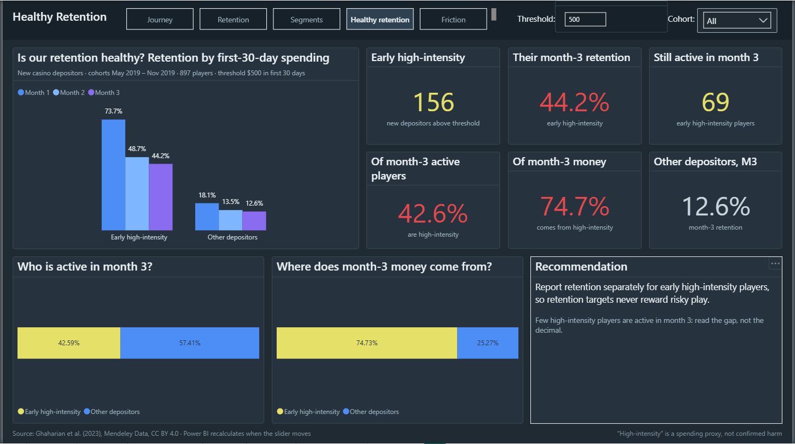
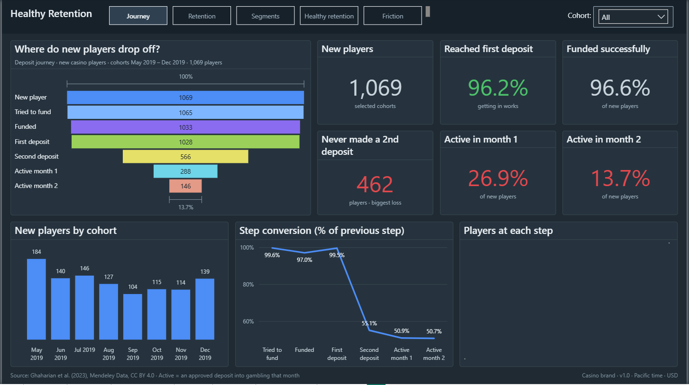
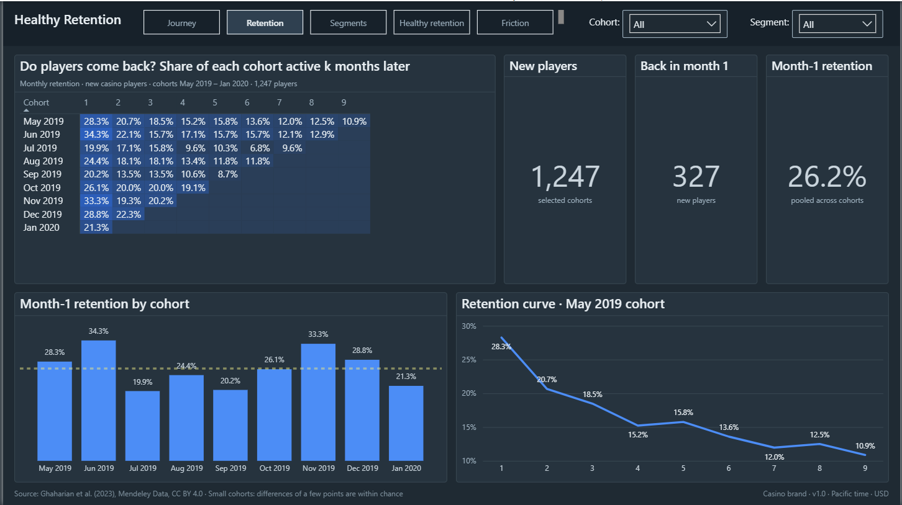
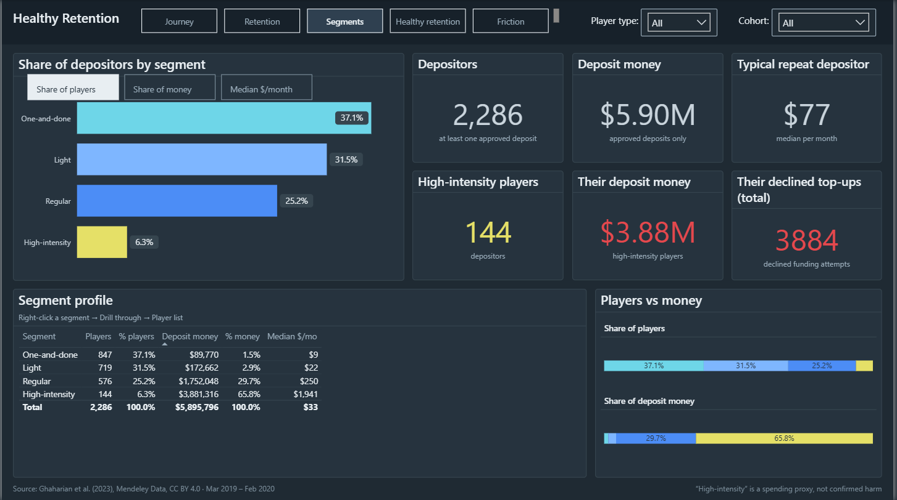
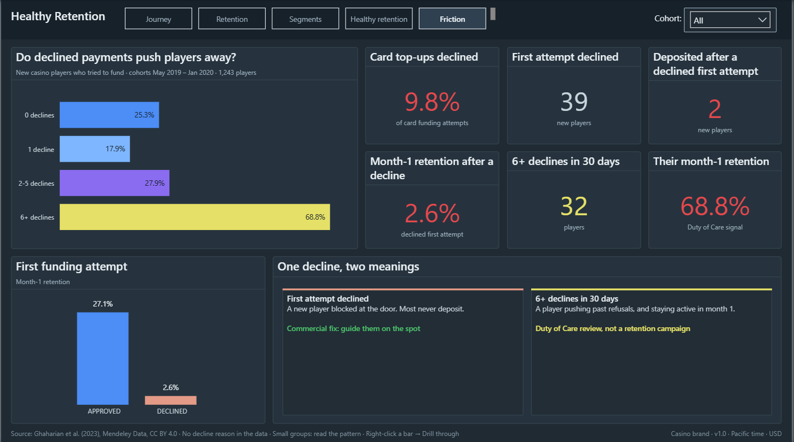
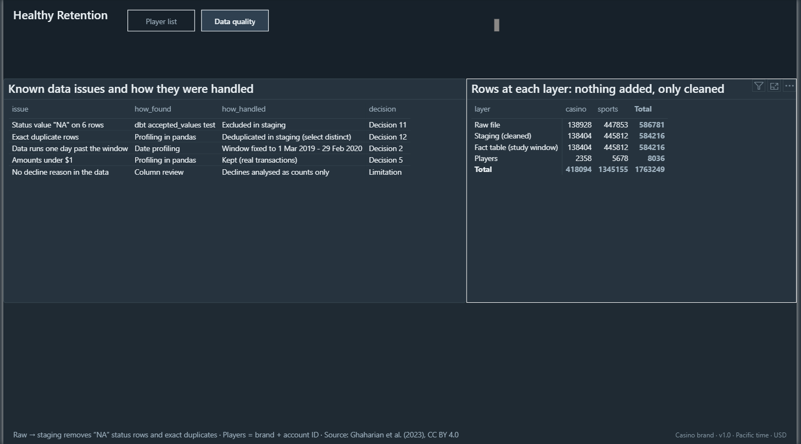

# Healthy Retention
### A player-journey analysis for a Duty of Care market

**Question:** Where do players drop off in their deposit journey, why do they leave, and how can
we keep recreational players engaged without retaining at-risk ones?



## Key findings (new casino players)

1. **The journey breaks after the first deposit, not before it.** 96% of new players reach a
   first deposit, but 462 of 1,069 (43%) never make a second one. Only 26.9% are active in month 1.
2. **Retention is driven by early high spenders.** Players who deposit $1,038+ in their first
   30 days are 3.2× more likely to be active in month 3 (45.9% vs 14.2%) and bring 63.3% of
   month-3 deposit money. A retention target can reward risky play without anyone noticing.
   → [Insight note](docs/insights/01_healthy_retention.md)
3. **One decline, two meanings.** A declined *first* payment loses the player (2 of 39 ever
   deposit). Six or more declines in 30 days comes with *higher* retention (68.8%): a
   Duty of Care signal, not loyalty.
   → [Insight note](docs/insights/02_payment_friction.md)

## Report pages

| Journey | Retention | Segments |
|---|---|---|
|  |  |  |

| Healthy retention | Payment friction | Data quality |
|---|---|---|
|  |  |  |

## How it is built

```
Raw CSV  →  PostgreSQL (raw)  →  dbt staging (clean)  →  dbt marts (star schema)  →  Power BI
```

- **SQL & PostgreSQL:** raw load, five analysis queries (`sql/analyses/`)
- **dbt:** staging + star schema (`fct_transactions`, `fct_player_month`, `dim_player`,
  `dim_date`, `dim_brand`), ~80 data tests, data-quality layer counts
- **Power BI:** import model, DAX measures (funnels, retention, what-if threshold slider,
  field parameter), PBIP format so the report and model are version-controlled
- **Python (pandas):** raw data profiling (`notebooks/`)
- **AI proofs of concept:** report pages designed in Claude Design and generated into PBIR
  files with Claude Code (`tools/gen_report.py`), then hand-checked in Power BI Desktop

Every layer reconciles to the one before it — see the Data quality page.

## Documentation

- [PRD](docs/PRD.md): problem, scope, success criteria
- [Decisions](docs/DECISIONS.md): 18 documented analytical decisions
- [Analyses](docs/analyses/): hypothesis-first write-up per analysis
- [Changelog](CHANGELOG.md)

## How to run

1. Download `Online_casino_DIB.csv` and `Online_sports_DIB.csv` from
   [Mendeley Data](https://data.mendeley.com/datasets/9j5gcygnwg/1) into `data/raw/`.
2. Create a PostgreSQL database `healthy_retention`, then load the data:
   ```
   psql -d healthy_retention -f sql/01_create_raw_tables.sql
   psql -d healthy_retention -f sql/02_load_raw.sql
   ```
3. Set up Python and build the models:
   ```
   python -m venv .venv
   .venv\Scripts\Activate.ps1
   pip install -r requirements.txt
   cd healthy_retention_dbt
   dbt build
   ```
   Needs a `profiles.yml` pointing at your database. One known warning: raw sports status.
4. Open `powerbi/HealthyRetention.pbip` in Power BI Desktop and refresh.

## Data and licence

Ghaharian, K., Puranik, P., Abarbanel, B., Taghva, K., Kraus, S. W., Singh, A., Feldman, A.,
& Bernhard, B. (2023). Payments transaction data from online casino players and online sports
bettors. *Data in Brief*, 48, 109077. https://doi.org/10.1016/j.dib.2023.109077

Dataset: [Mendeley Data, doi:10.17632/9j5gcygnwg.1](https://doi.org/10.17632/9j5gcygnwg.1),
licensed CC BY 4.0. The raw files are not stored in this repo.

## Limitations

- One US operator, one year (Mar 2019 – Feb 2020); payments only, no gameplay or clickstream.
- "High-intensity" is a spending proxy, not confirmed harm.
- No decline reason in the data; several groups are small (28–50 players).
- Findings are associations, not causes.

**Author:** Mohammed Khaled · [LinkedIn](https://www.linkedin.com/in/mohammed-khaled-43a220183)